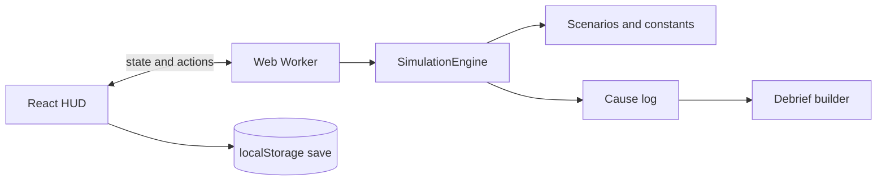

# Ares Horizon

A browser game and simulation engine for running a crewed outpost on Mars or the Moon.
Power, air, water, heat, food and radiation depend on each other, so every decision has a cost somewhere else.
Built for the NASA Space Apps Challenge on crewed lunar and Martian outposts.

**Live demo:** [https://p243120-collab.github.io/ares-horizon/](https://p243120-collab.github.io/ares-horizon/)

## What it does

- Coupled life-support model: solar and nuclear power, battery, CO2 scrubber, water recycler, electrolysis, Sabatier reactor, hydroponics, radiator louvers, heater, regolith shielding.
- Individual crew with health, stress and radiation dose.
- Seeded random events: dust storm, solar particle event, micrometeorite puncture, power surge. Same seed, same mission, so a whole class can face the same run.
- Delayed advice from Earth (the delay is scaled for gameplay).
- A debrief that traces each crisis back to its causes and explains the science.
- Two missions: The Martian Dust Winter, and Lunar Night at the South Pole Ridge.
- Runs entirely in the browser. No server, no accounts, free to host.

## Quick start

```bash
npm install
npm run dev        # play at the printed local address
npm test           # engine tests (physics, determinism, balance, debrief)
npm run build      # production build in dist/
```

Or use the automation script: `python scripts/ares_setup.py verify`.

## How it is built



The engine in `src/engine` is pure TypeScript with no DOM, so it is fast to test and easy to reason about.
See `docs/ARCHITECTURE.md` for the time-scaling maths and how to extend the game.

## Implemented and planned

| Area | Status |
|---|---|
| Deterministic engine, 2 scenarios, events, crew, debrief | Implemented |
| Unit, determinism and balance tests, CI | Implemented |
| Save, continue and JSON export of runs | Implemented |
| Verified and cited data (docs/SOURCES.md) | In progress |
| Pre/post learning quiz, tutorial | Planned |
| Classroom mode (free Supabase tier) | Planned |
| Isometric PixiJS map | Planned |

`docs/BLUEPRINT.md` holds the original enterprise design. It is the long-term roadmap, not what is built today.

## Honest limits

Rates and sizes are simplified for gameplay. Every value marked ASSUMPTION in `src/engine/constants.ts` and `scenarios.ts` is tracked in `docs/SOURCES.md` until it is verified against a NASA source.

## Team

(fill in: names, roles and what each person built, task T10)
